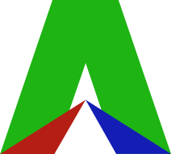

<!--

  

 -->

Act Engine it's a simple, lightweight, code-first engine that provides the basic features for making a game.

It is written in C++17, with nothing extra to install (with exception of CMake to compile the engine).

It's licensed under the Boost Software License (BSL), which is very permissive.
